# Randomness {.center background-color="#041E42" style="color: #d6d6d6; text-align: center;"}

:::{.notes}
As part of understanding what we mean by 'chance', today we're going to talk about why we care about quantifying uncertainty, how to categorise experiment outcomes, and some mathematical rules for calculations with probability. First up, randomness!
:::

## Events

When we say an event happens **randomly**, what does that mean?

. . .

::::: {.columns}
:::: {.column width="50%"}
::: {.incremental}
Examples of **events**:

1. You roll a six with a die.
2. You roll two sixes with a pair of dice.
3. A medical test gives a positive result.
4. A filter labels an email as 'spam'.
5. More than 20cm of snow falls in Edinburgh in a single day.
:::
::::

:::: {.column width="50%"}
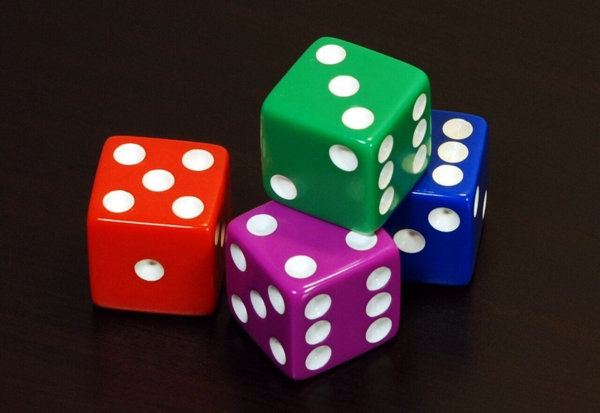{fig-align="center" width=80% fig-alt="A picture of four six-sided dice, or d6. The red die shows 5, 1 and 3. The magenta die shows 4, 5 and 6. The blue die shows 6, 3 and 2. The green die shows 3, 2 and 6."}
::::

:::::

. . .

Let $A$ be an event. The **probability** of $A$ happening is denoted $\mathbb{P}(A)$.

:::{.notes}
The easiest way into this topic is through some examples of what we mean by an 'event' and its probability. For each, talk about the possible outcomes, that the event event 'occurs' or not. For medical test results, highlight that not all events are ones we think about as 'random' and highlight factors that might impact that.

Throughout we're going to use some standard notation. Capital letters at the beginning of the alphabet for events. Blackboard P for probability, then read as P of A for probability of A occurring.
:::

## Experiments

Experiments have a **sample space** (denote $\Omega$) of possible outcomes.

. . .

| Experiment  | $\Omega$ (Sample Space) |
| :---------- | :---------------------- |
| [Roll a dice]{.incremental} | $\lbrace 1,2,3,4,5,6 \rbrace$ |
| Roll two dice | $\lbrace (1,1), (1,2), (1,3), \ldots, (1,6), (2,1), \ldots (6,6)\rbrace$ |
| Medical test | $\lbrace\!$ Positive, Negative $\!\rbrace$ |
| Toss a coin | $\lbrace \text{H}, \text{T} \rbrace$ |
| Toss a coin until heads | $\lbrace \text{H}, \text{TH}, \text{TTH}, \text{TTTH}, \ldots \rbrace$ |
| Human lifetime | $0 \leq t < \infty$ |

. . .

We refer to events found in a sample space as **elementary events**.

:::{.notes}
Define experiment in a little more detail, and highlight that these can be  orchestrated (like a lab experiment) or an observation of a natural phenomena.

For each example in the table, talk about where the sample space comes from. After, ask whether there are any that jump out as different. Mix of categorical, discrete, continuous, countable, and uncountable.
:::

## Probability

Events can be more than elementary! [A **non-elementary event** could be $A =$ "roll even".]{.fragment}

| Experiment  | $\Omega$ (Sample Space) |
| :---------- | :---------------------- |
| Roll a dice | $\lbrace 1,2,3,4,5,6 \rbrace$ |

. . .

If $A$ is the event we are interested in, we can calculate the **probability** of $A$ happening by

$$
  \mathbb{P}(A) = \frac{\text{# outcomes where $A$ occurs}}{\text{# outcomes in the sample space}}
$$

. . .

For example, if $X$ is outcome on a die,

:::::{.columns}
::::{.column width=50%}
:::{.incremental}
- $\mathbb{P}(X=3) = \frac{1}{6}$ [$\approx 0.167$,]{.fragment}
- $\mathbb{P}(X \in\lbrace 2,4,6 \rbrace) = \frac{3}{6}$ [$= 0.5$,]{.fragment}
:::
::::

::::{.column width=50%}
:::{.incremental}
- $\mathbb{P}(X < 3) = \frac{2}{6}$ [$\approx 0.333$,]{.fragment}
- $\mathbb{P}(X \geq 7) = \frac{0}{6}$ [$= 0$.]{.fragment}
:::
::::
:::::

:::{.notes}
It will hopefully be intuitive to that not all the events that we care about are elementary. However, the notation used to communicate that may well be unseen.

Talk through the four final examples in words, explaining the notation and then where the fraction comes from. Only then reveal the decimal, before finally giving the equivalent percentage.
:::

## Certainty

. . .

We often wish to know the **certainty** that an event occurs. [We quantify this as **chance**.]{.fragment}

. . .

Most of us are not very consistent at quantifying how certain we are about something.

:::{#fig-certainty layout-ncol=2 fig-alt="Results of a public survey showing the distribution of respondents estimate of likelihoods for a set of words and phrases."}
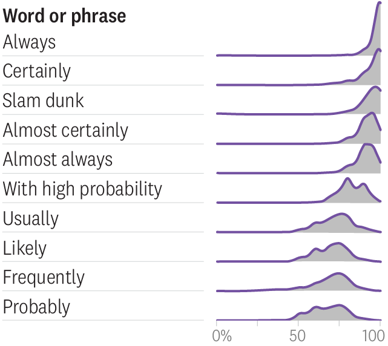{fig-align="center" width=75%}

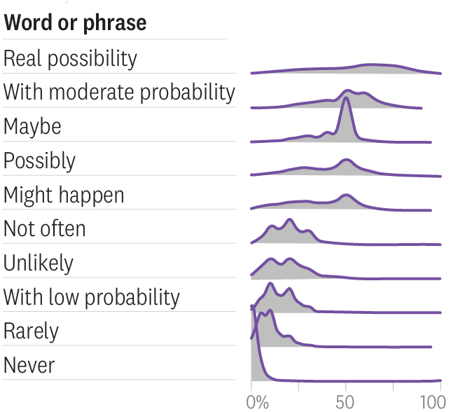{width=73% fig-align="center"}

Distribution of responses according to respondents' estimate of likelihood. See [probabilitysurvey.com](https://www.probabilitysurvey.com/)
:::

:::{.notes}
Why do we care about probability? Why is it useful?

1. The probability that a medical test gives a positive result if a patient has a certain disease tells us how sensitive that test is.

2. The probability that a spam filter labels an email message containing a real job offer as 'spam' tells you whether your spam filter is too sensitive.

3. The risk that more than 20 cm of snow falls in Edinburgh in a single day at least once next winter tells us whether the city should invest in more snowploughs.

But why do we quantify that mathematially? Numberline exercise, then talk through the students results compared to the wider public.

How certain or uncertain we are about a particular event, humans are inherently bad at quantifying this. Statistical methods utilising probability theory allow us to say that we are 95 % certain about something – and actually mean it!
:::

# Venn Diagrams {.center background-color="#041E42" style="color: #d6d6d6; text-align: center;"}

## Idea

If we more than one event ($A$ and $B$ say), it's useful to have a way to visualise what outcomes in $\Omega$ relate to what event. [We can do this with **Venn diagrams**.]{.fragment}

. . .

](../Images/university_website.png){fig-alt="A Venn diagram. The left circle is labelled 'Things on the front page of a university website' and contains: campus photo slideshow, alumni in the news, and a statement of the school's philosophy. The right circle is labeled 'Things people go to the site looking for' and contains: campus address, application forms, and academic calendar. The only item in the overlapping section is 'full name of school'."}

:::{.notes}
Events are defined in terms of sets of outcomes. In the following examples, let $A$ and $B$ be such sets.

Events are not numbers, and can not be added or subtracted like such. There are however other important mathematical operators for events.
:::

## Union

The union $A\cup B$ is the combination of both, _i.e._ outcomes in at least one of $A$ **or** $B$.

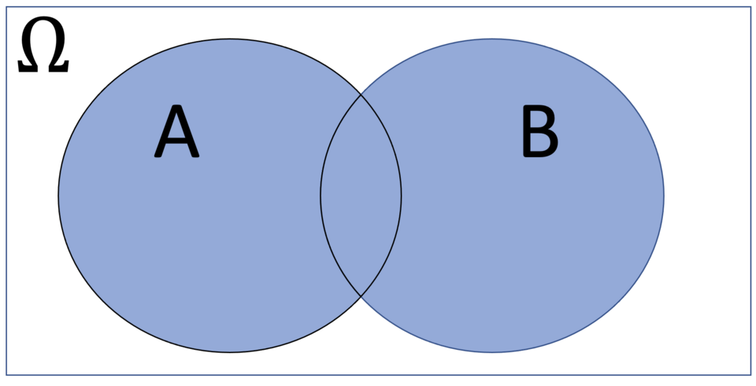{width=70% fig-alt="Depiction of the union of two sets as the area of two overlapping circles." fig-align="center"}

. . .

For example, if $A$ is 'roll even' and if '$B$ is 'roll greater than 3', then $A \cup B = \lbrace 2, 4, 5, 6\rbrace$.

## Intersection

The intersection $A \cap B$ is the overlap of both, _i.e._ outcomes in both $A$ **and** $B$.

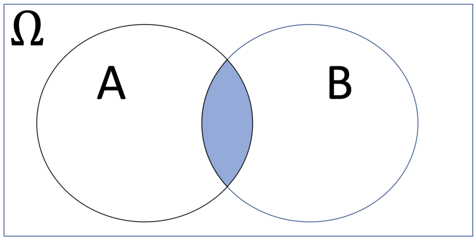{width=70% fig-alt="Depiction of the intersection of two sets as the area in common between two overlapping circles." fig-align="center"}

. . .

For example, if $A$ is 'roll even' and if '$B$ is 'roll greater than 3', then $A \cap B = \lbrace 4, 6\rbrace$.

## Difference

The difference $A\backslash{}B$ are the outcomes in $A$ but **not** in $B$.

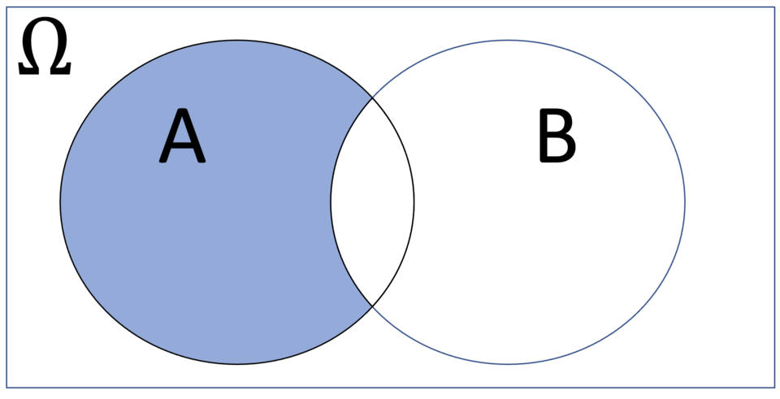{width=70% fig-alt="Depiction of the difference between two sets as the area exclusively in one of two overlapping circles."  fig-align="center"}

. . .

For example, if $A$ is 'roll even' and if '$B$ is 'roll greater than 3', then $A \backslash{} B = \lbrace 2 \rbrace$.

## Compliment

The **complement** $A^{\text{C}}$ (also denoted $A^∗$, or $\bar{A}$) is all the outcomes not in $A$, _i.e._ $\Omega\backslash A$.

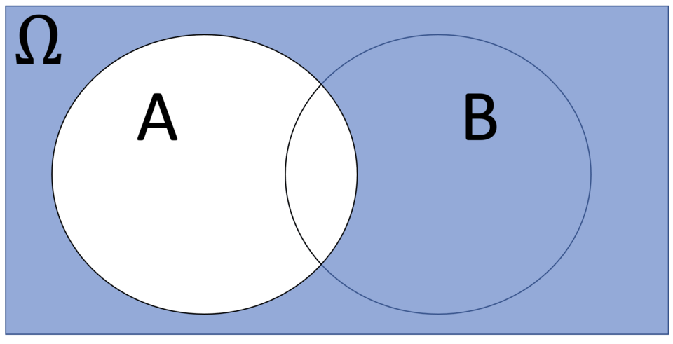{width=40% fig-alt="Depiction of compliment of a set as the area outside a circle." fig-align="center"}

. . .

For example, if $A$ is 'rolls a 3', $A = \lbrace 3\rbrace$. The compliment of $A$ would be

$$
  A^{\text{C}} = \Omega\backslash\lbrace3\rbrace = \lbrace 1,2,4,5,6 \rbrace.
$$

## Exclusive

Two events $A$ and $B$ are **mutually exclusive** if they have no overlapping outcomes.

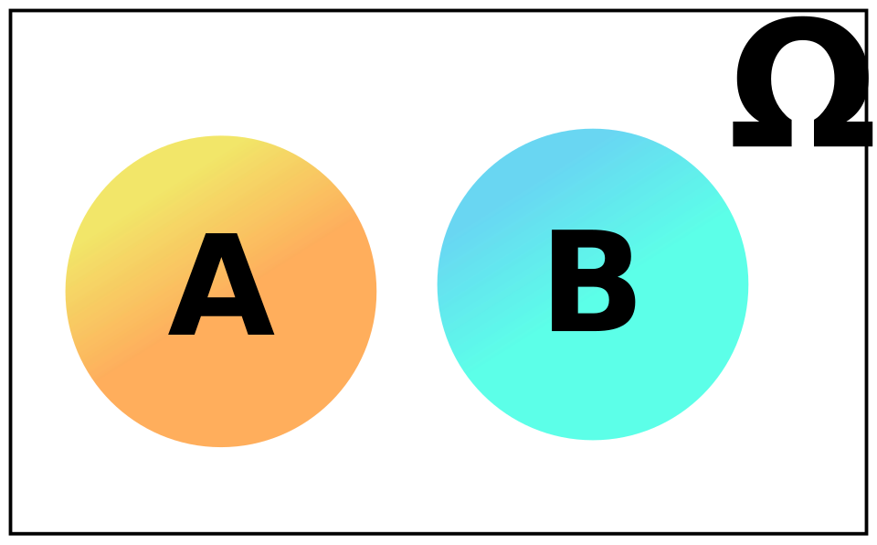{width=35% fig-alt="Depiction of two mutually exclusive sets as two non-overlapping circles." fig-align="center"}

. . .

For example, if $A = \lbrace 1,3,5 \rbrace$ ('roll odd') and $B = \lbrace 2,4,6 \rbrace$ ('roll even').

# Probability Rules {.center background-color="#041E42" style="color: #d6d6d6; text-align: center;"}

:::{.notes}
With operations on events defined, we can do the same for probability. 
:::

## Axioms

We are now ready to give a definition of the probability $\mathbb{P}(A)$, and to derive some rules.

. . .

:::::{.columns}
::::{.column width=55%}
These are known as **Kolmogorov's axioms**.

[If $\mathbb{P}$ measures probability, with $A$ and $B$ denoting events in $\Omega$, then:]{.fragment}

:::{.incremental}
1. $0 \leq \mathbb{P}(A) \leq 1$ for all events $A$ in $\Omega$;
2. $\mathbb{P}(\Omega) = 1$;
3. If $A \cap B = \emptyset$ then[^empty] $$\mathbb{P}(A \cup B) = \mathbb{P}(A) + \mathbb{P}(B).$$
:::
::::

[^empty]: '$\emptyset=\lbrace\rbrace$' is the **empty set**. 

::::{.column width=45%}
{fig-align="center" fig-alt="Photograph of Andrej Kolmogorov leafing through a book."}
::::
:::::

:::{.notes}
Andrey Nikolaevich Kolmogorov was a Soviet mathematician who played a central role in the creation of modern probability theory. An axiom is mathematical terminology meaning 'fundamental given truth'.

Give a 'plain English' explanation of each axiom; 

1. Probabilities have to be between zero and one, so can't be negative and can't be more than 100%.

2. The probability that the outcome is from the sample space is one.

3. If A and B are mutually exclusive, then the probability of A or B happening is the probability of A plus the probability of B.

How do we use these axiom
:::

## Inclusion-Exclusion

We can use Venn diagrams to build an intuition for how probabilities are calculated.

. . .

**Question:** if we know the three probabilities,

:::{layout-ncol=3}
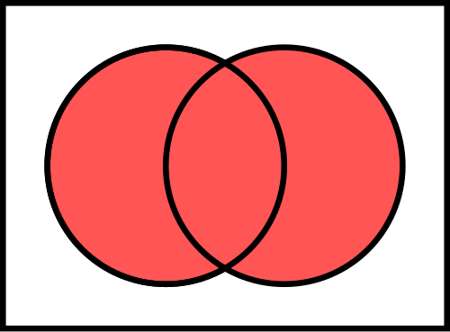{fig-align="center" width=90% fig-alt="Venn representation of everything except A union B."}

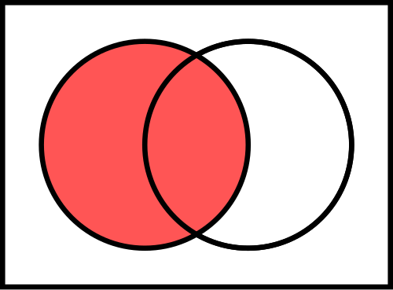{fig-align="center" width=90% fig-alt="Venn representation of the event A"}

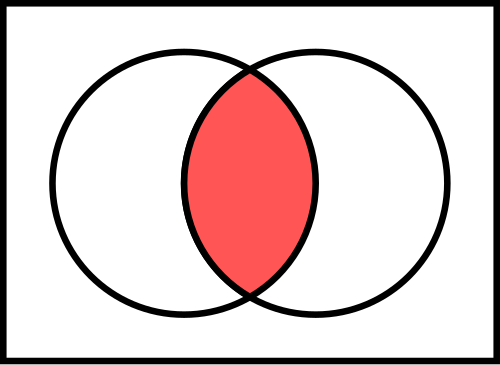{fig-align="center" width=90% fig-alt="Venn representation of the intersect of A and B."}
:::

then what is is $\mathbb{P}(B)$?

. . .

**Answer:**

$$
  \mathbb{P}(B) = \mathbb{P}(A \cup B) - \mathbb{P}(A) + \mathbb{P}(A \cap B).
$$

:::{.notes}
Encourage students to focus on the Venn diagram areas, rather than the probabilities. How could we add and subtract the given areas to get the area representing B?
:::

## Example

. . .

Two medical conditions are **comorbid** if they occur at the same time as each other.

Surveys have estimated that 7% of children have asthma, 30% have eczema, and for 2% of children the conditions are comorbid.

What is the probability a child has either condition?

. . .

::::{.callout-tip title="Hint"}
:::{.incremental}
1. If $\mathbb{P}(A) = 0.07$, $\mathbb{P}(E) = 0.3$, and $\mathbb{P}(A \cap E) = 0.02$, then what is $\mathbb{P}(A \cup B)$?
2. Remember, $\mathbb{P}(A \cup B) = \mathbb{P}(A) + \mathbb{P}(B) - \mathbb{P}(A \cap B)$.
:::
::::

. . .

**Solution: ** 35% of children have asthma or eczema, since

$$
  \mathbb{P}(A \cup B) = \mathbb{P}(A) + \mathbb{P}(B) - \mathbb{P}(A \cap B) = 0.07 + 0.3 - 0.02 = 0.35
$$

:::{.notes}
Can use what we've seen now to answer real-world problems! Following is an example of a 'word problem', essentially a maths question provided in some real world context. These are typical of maths education in Scotland.
:::

